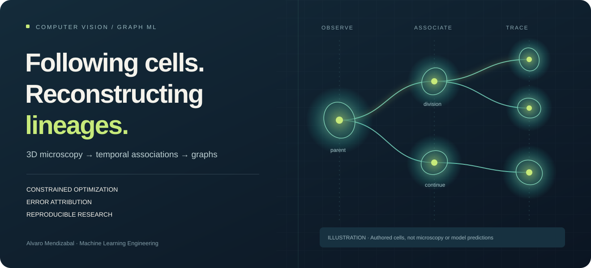
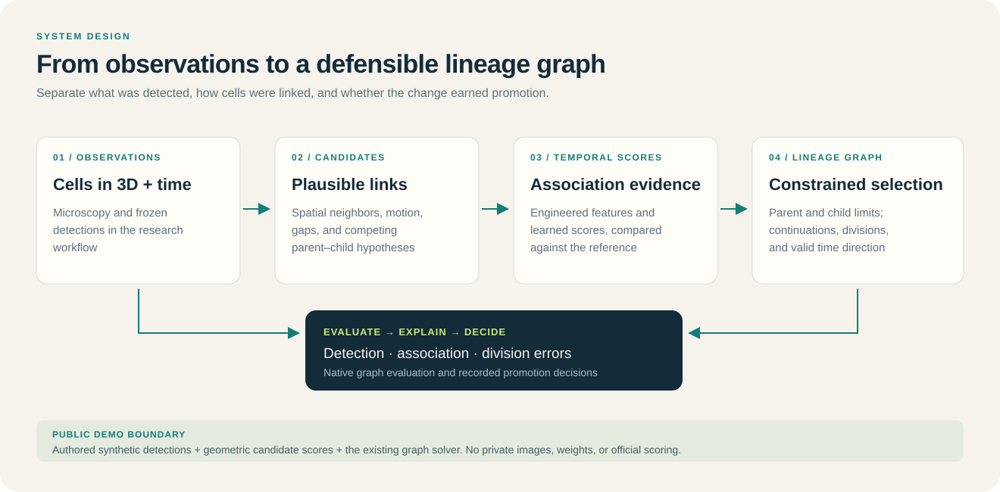

# 3D Cell Tracking & Lineage Reconstruction

**Alvaro Mendizabal · Computer vision · Constrained optimization · ML systems**

[](https://github.com/alvaromendizabal/biohub-cell-tracking-during-development/actions/workflows/portfolio.yml)



I integrated a volumetric tracking system, built graph-level fidelity checks, and made association decisions inspectable through a reproducible CPU pipeline and interactive lineage explorer.

**Retained historical score: 0.947.** The Harmonic Fusion system uses credited upstream architectures and pretrained artifacts. My contribution is integration, evaluation, optimization and inspection tooling—not independent authorship of the pretrained system. [Attribution](ATTRIBUTION.md) · [Original scoring receipt](reports/official_submission.json)

[**Open the lineage explorer ↗**](https://alvaro-cell-lineage-explorer.tartmacaw2.chatgpt.site) · [Case study](CASE_STUDY.md) · [Run locally](REPRODUCE.md) · [Executed graph example](examples/lineage_reasoning.ipynb)

## From detections to a coherent lineage



| Component | Inspect the implementation | Responsibility |
|---|---|---|
| Volumetric model interfaces | [Model components](src/biohub_tracking/public_reproduction/models.py) | Credited detection and association architectures |
| Bidirectional fusion | [Harmonic kernel](src/biohub_tracking/fusion.py) | Retained reciprocal arithmetic with caller-supplied weights and malformed-input checks |
| Constrained association | [Graph solver](src/biohub_tracking/public_graph_methods.py) | One parent per child and bounded children per parent |
| Output fidelity | [CSV comparison](scripts/reproduce_final_evidence.py) | Exact identities; edge changes separated from coordinate drift |
| Runnable example | [Synthetic pipeline](src/biohub_tracking/synthetic_demo.py) | Images, candidates, solved graphs and exact-ID diagnostics on CPU |

## Run and inspect

With Python 3.12:

```bash
python -m pip install --require-hashes -r requirements-test.lock
python -m pip install --no-deps --no-build-isolation -e .
python examples/run_tracking_demo.py --output public-demo
python scripts/run_ci.py
```

Open `public-demo/index.html`. Scrub through the twelve-frame movie, select a cell, and inspect its ancestry. Change the threshold, child limit or gap policy: the browser recomputes the graph. Candidate explanations and reference-policy comparisons show exactly which links changed and why.

This is **authored synthetic microscopy**, not private competition data or a new biological measurement. [Complete setup and replay checks](REPRODUCE.md)

## Evidence that determined the release

| Evidence | Recorded result | Scope |
|---|---:|---|
| Retained system | **0.947** | Historical external scoring receipt |
| Later candidate | **0.946** | Rejected after external regression |
| Output-fidelity audit | **8 changed edges / 4 movies** | Same detections and shared coordinates |
| Motion-linking optimization | **34.7×** | Component benchmark with selected-edge parity; not total latency |

[Results and limitations](RESULTS.md) · [Unmodified aggregate record](reports/portfolio_summary.json)

## Quality and publication boundary

CI tests malformed identities, finite coordinates, corrupt fixtures, constrained assignment, numerical fusion parity and graph-change accounting. It regenerates the fixture twice, compares its bytes with the published version, and tests the actual browser handlers against Python policies and exhaustive small-graph optima.

The maintained tree contains model components, public fusion arithmetic, the graph solver, runnable examples, tests and compact final evidence. Abandoned experiment implementations and private-runtime stubs are not presented as public capabilities. Private volumes, model weights, tuned fusion settings and full inference orchestration are not distributed. Public reproduction demonstrates component behavior; it does not recreate the historical private competitive score.

[Engineering overview](docs/ENGINEERING_OVERVIEW.md) · [Model card](docs/MODEL_CARD.md) · [License notices](THIRD_PARTY_NOTICES.md) · [Publication scope](docs/PUBLICATION_SCOPE.md)
